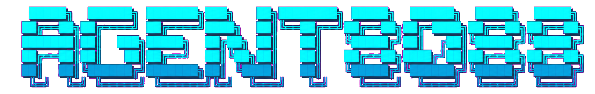
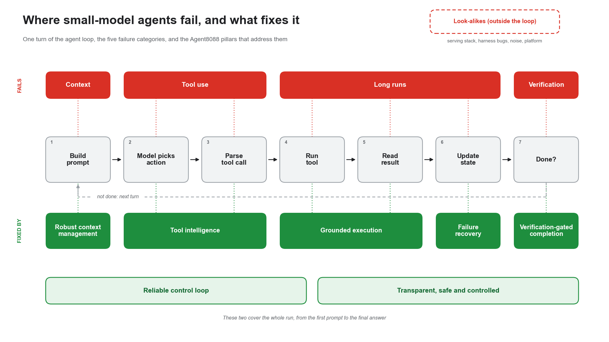

<p align="center">
  
  <br>
  
</p>

<p align="center">
  <strong>Reliable AI agents&mdash;even on small, local models.</strong>
</p>

<p align="center">
  <a href="#demo">Demo</a> ·
  <a href="#about">About</a> ·
  <a href="#quick-start">Quick start</a> ·
  <a href="#inside-agent8088">Features</a> ·
  <a href="#documentation">Documentation</a> ·
  <a href="https://palindromerl.com/blog/agent8088-agentic-harness">Blog</a> ·
  <a href="#contributing">Contributing</a>
</p>

<p align="center">
  <a href="https://github.com/palindrome-rl/AGENT8088/actions/workflows/ci.yml"></a>
  <a href="LICENSE"></a>
  <a href="https://www.python.org/downloads/"></a>
  <a href="https://github.com/palindrome-rl/AGENT8088/tree/AGENT8088-v1.3"></a>
  
  
</p>

<p align="center">
  
  
  
  
  
  
  
</p>

## Demo

<p align="center">
  <a href="assets/demo.mp4">
    
  </a>
</p>

## About

Agent8088 is an open-source agentic harness from Palindrome Research Labs, built to make small local models finish real agentic tasks reliably.

Most harnesses assume a large model and trust whatever it reports. Agent8088 fixes the limitations and failure modes of small models through research-backed harness engineering.

Small models mostly fail in specific ways. Their context overflows without warning, their tool calls are malformed or wrongly chosen, they say they are done when they are not, and long runs end up looping or losing progress.

Agent8088 handles these areas around the model through Context Management, Tool Intelligence, Verification-Gated Completion, Grounded Execution, a Reliable Control Loop, Failure Recovery and code-enforced safety. Bigger models mostly show similar failures but less often, so it helps them too.

Apart from focusing on small models reliability, Agent8088 is a complete agentic harness, with broad tooling, web research, documents, MCP, sub-agents, memory and a choice of terminal, web and chat front ends.

<table>
  <tr>
    <td width="33%" valign="top">
      <strong>Small-model-first</strong><br>
      <sub>Efficient prompts, minimized tool schemas, model-aware routing, and local-model support make capable local models practical.</sub>
    </td>
    <td width="33%" valign="top">
      <strong>Tool intelligence</strong><br>
      <sub>Hybrid tool selection, tolerant call parsing, validated arguments, shaped tool results, and lazy-loaded skills help models choose and use the right tools.</sub>
    </td>
    <td width="33%" valign="top">
      <strong>Robust context management</strong><br>
      <sub>Pre-call token budgeting, overflow prevention, compaction that keeps your instructions word for word, content handles, and persistent task state preserve what matters within the window.</sub>
    </td>
  </tr>
  <tr>
    <td width="33%" valign="top">
      <strong>Verification-gated completion</strong><br>
      <sub>Tasks are checked against their required outputs, tests, and observable tool results before completion is reported, with honest verification labels and an optional independent audit.</sub>
    </td>
    <td width="33%" valign="top">
      <strong>Grounded execution</strong><br>
      <sub>Work proceeds through structured tools and observable results, so each step is checked against real files, test output, and system state rather than the model's own claims.</sub>
    </td>
    <td width="33%" valign="top">
      <strong>Reliable control loop</strong><br>
      <sub>A persistent loop plans, acts, and observes, detects repeats and stalls, replans after failures, enforces time and round limits, and escalates to a stronger model only when needed to keep runs moving.</sub>
    </td>
  </tr>
  <tr>
    <td width="33%" valign="top">
      <strong>Failure recovery</strong><br>
      <sub>Rollback of failed file changes, resumable tasks, overflow and cut-off retries, and halting at the first failed step keep long runs recoverable.</sub>
    </td>
    <td width="33%" valign="top">
      <strong>Transparent, safe and controlled</strong><br>
      <sub>Permission modes, usage and cost monitoring, audit trails, credential protection, SSRF and egress security controls, and OS-level sandboxing keep actions accountable.</sub>
    </td>
    <td width="33%" valign="top">
      <strong>Low-friction and extensible</strong><br>
      <sub>Use the CLI or web UI, connect local or hosted models, and extend the harness through MCP, skills, sub-agents, and gateways.</sub>
    </td>
  </tr>
</table>

<p align="center">
  
</p>

**Read the full write-up:** [Agent8088: Agentic Harness for Reliable AI Agents, even on small, local models](https://palindromerl.com/blog/agent8088-agentic-harness)

---

## What's new in v1.3

- **Task completion:** each part of a request is checked against delivered output; smoke tests separate "could not start here" from real crashes.
- **Verification you can read:** each answer says how well its changes were checked (tested, only run, or failed), and a failing check shows as NOT VERIFIED at the top.
- **Long-running tasks:** time and round budget warnings, stall decisions, and your rules kept word for word through compaction.
- **Credential safety:** secret scanning on pasted text and written files; attachments isolated per session.
- **File handling:** byte-exact `copy_file` and `move_file`; a generated project stays in one folder, and a folder you ask to put in `artifacts/` goes there.

Includes the v1.2 reliability fixes; existing configuration and memory are preserved. See the [CHANGELOG](CHANGELOG.md).

## Quick start

### Install Agent8088 v1.3

The commands below install the public v1.3 branch. `agent8088 --update`
continues to use this branch.

**macOS, Linux, or WSL2**

```sh
curl -fsSL --proto '=https' --tlsv1.2 https://raw.githubusercontent.com/palindrome-rl/AGENT8088/AGENT8088-v1.3/install.sh | AGENT8088_BRANCH=AGENT8088-v1.3 bash
```

**Windows (PowerShell)**

```powershell
$env:AGENT8088_BRANCH = "AGENT8088-v1.3"; iex (irm https://raw.githubusercontent.com/palindrome-rl/AGENT8088/AGENT8088-v1.3/install.ps1)
```

Use these branch-specific installers for v1.3; the generic Pages installer
may track a different release.

Run the Windows command in PowerShell, not Command Prompt. On macOS/Linux,
run as your normal user, without `sudo`; the installer asks for elevated access
only when a system component needs it.

If Windows Terminal cannot be installed or launched, you can install in the
current PowerShell window by setting `$env:AGENT8088_SKIP_TERMINAL_CHECK = "1"`
and rerunning the Windows command above. This skips only the terminal-host check;
it does not disable antivirus or change execution policy. Windows Terminal
remains the supported host for the best display.

The installer provisions an isolated Python environment, installs the global `agent8088` command, and can run the setup wizard. No administrator access is required for the base install.

<details>
<summary><b>What the installer provisions, and supported platforms</b></summary>

**What the installer provisions automatically:**

| Component | Linux / macOS | Windows |
| --- | --- | --- |
| Core agent (chat, tools, MCP, search) | yes | yes |
| Gateway adapters (Slack, Discord, WhatsApp, Telegram) | yes | yes |
| Playwright Chromium (`browse_page`) | yes | yes |
| Node.js 22 + WhatsApp bridge npm deps | yes | yes (portable, no admin) |
| Native sandbox runtime | yes (auto-setup) | yes (auto-setup, no admin needed) |

### Supported platforms

| Platform | Status | Notes |
|---|---|---|
| macOS 12+ (Apple Silicon & Intel) | Supported | `install.sh` |
| Ubuntu / Debian / Fedora / Arch (x64, arm64) | Supported | `install.sh` |
| WSL2 | Supported | `install.sh`; clone with LF line endings, not CRLF |
| Windows 10 (1903+) / 11, in Windows Terminal | Supported | `install.ps1` |
| Windows Server, legacy Console Host, PowerShell ISE | Not supported | needs a modern terminal host — see `install.ps1`'s terminal check |
| Alpine / other non-glibc Linux | Best-effort | works if bash, curl-or-wget, and Python 3.10+ are present |
| Corporate proxy (`HTTP_PROXY`/`HTTPS_PROXY`) | Supported | both installers honor standard proxy env vars |

</details>

After installing, start `agent8088` and run `/doctor [--fix]` to verify your setup, or
`/dump` to produce a bundle for a bug report.

If installation fails, the installer reports the failed step, keeps its output,
and prints a retry command. Logs are saved to
`%LOCALAPPDATA%\agent8088\install.log` on Windows or
`~/.agent8088/install.log` on macOS/Linux (under `AGENT8088_HOME` when set).
Rerun the same command to resume; optional failures are listed separately from
core startup failures. See [installation troubleshooting](docs/wiki/13-troubleshooting.md#installation-fails-or-stops).

The Windows installer verifies dependencies by running their executables,
importing installed Python/Node packages, checking Chromium and OCR resources,
and validating WebUI assets. A stale resume marker or partial dependency folder
triggers repair instead of being treated as success.

The installers do not add the `[dev]` extra (pytest, ruff, pip-audit). It is
not needed to install or run Agent8088.

---

## Configure and run

```sh
agent8088 --setup            # choose a provider, model, workspace, and search backend
agent8088                    # start the interactive agent
```

The setup wizard stores API keys in `~/.agent8088/.env` rather than `config.txt`. Start with a local Ollama model or select a hosted provider; the agent can switch models later with `/model` or `/models`.

`full-auto` is the default permission mode: the agent works without per-action prompts inside the workspace, with the always-on safety floor still enforced. Use `--mode readonly` to approve writes, network access, and shell commands one at a time.

> The installer sets up the native sandbox automatically. If setup did not finish, run `agent8088 --sandbox-setup` to retry. On Windows, use your normal, non-admin terminal: the backend restricts file writes using the current account and does not create a separate sandbox account. For network isolation on Windows, use `sandbox_backend=docker`.

### Use the web UI

See the [Web UI CLI reference](docs/wiki/10-cli-reference.md#web-ui) for details.

```sh
agent8088 --web          # production build   -> http://127.0.0.1:8180
uv run agent8088 --web   # development (FastAPI + Vite) -> http://127.0.0.1:5180
```

The first source-checkout run needs `npm install` in `web`; production builds the frontend automatically when needed.

Web flags: `--web` · `--web-port PORT` · `--web-host HOST` · `--web-dev`

### A few useful commands

| Command | Purpose |
| --- | --- |
| `agent8088` | Start an interactive session. The first message automatically creates a saved chat; use `/sessions` and `/resume <name>` after restarting. |
| `agent8088 --memory-setup` | Add the mem0 memory engine to an existing install (installs the backend deps and makes mem0 the default engine). The installers offer the same choice up front: `-WithMem0`/`-SkipMem0` (PowerShell) or `--memory mem0`/`--memory native` (bash), plus an interactive prompt. Switch engines any time with `/memory engine native\|mem0` — both stores are kept. |
| `agent8088 --uninstall` | Remove the install dir, config, env vars, and cron/scheduled-task entries. Add `--workspace` to also remove trace logs + WhatsApp session data, or `--dry-run` to preview first. |
| `agent8088 --gateway-setup` | Configure Slack, Discord, WhatsApp, Telegram, or email. |
| `agent8088 --gateway` | Run the messaging gateway. |
| `agent8088 --prompt-file PATH` | Run one unattended, full-auto task from a UTF-8 file. Use only in a trusted, isolated environment. |
| `agent8088 --mcp-serve` | Expose Agent8088's safe tools over MCP stdio. |
| `/plan <task>` | Research, propose a plan, and wait for your approval before mutations. |
| `/capabilities` | Show the live tool, MCP, sandbox, skill, sub-agent, and guardrail configuration. |
| `/limits [key value]` | Show every turn, budget, sub-agent, and tool limit, or change one (for example the starting rounds or the tool-timeout ceiling); changes are saved to your config. |
| `/cli-anything <task>` | Find, install, run, build, refine, test, or validate an application CLI through the experimental CLI-Anything integration. |
| `/doctor [--fix]` | Check local setup and report likely problems; `--fix` repairs a broken web-search install. |
| `/dump` | Write a redacted diagnostic bundle (`dump-<date>-<time>.txt` in the data folder) for sharing in a bug report. |
| `/save [file]` | Export the conversation and trace to JSON. Without a name it writes a new date-stamped file, so earlier saves are kept. |

In the web UI, you can start or resume another chat while a task runs. Its
answers and approval requests stay in the original chat. Messages sent while
a task runs are queued for the chat where you entered them; only one task
runs at a time. A running chat cannot be renamed, deleted, reset, or compacted.

---

## Inside Agent8088

Most agent harnesses assume a hosted model and trust the model by default. Agent8088 is built the other way round:

- **Local-first and context-aware.** It runs on your own machine with local Ollama models. `/models local` checks your hardware and suggests models that fit. Memory, OCR, and session history are stored on disk and never uploaded. Context budgeting and compaction help long tasks continue without silently overflowing the model window.
- **Small-model-first and grounded.** Efficient prompts, minimized tool schemas, and model-aware routing make small local models practical, while a persistent control loop plans, acts through structured tools, observes results, and recovers when execution fails.
- **Verification before confidence.** Tool results, tests, smoke checks, expected deliverables, and execution state provide evidence for completion. Recovery paths help the agent retry, preserve useful progress, or surface a clear failure instead of pretending the task succeeded.
- **Security at the floor.** Credential paths, shell startup-file writes, destructive Git operations, and system-prompt exfiltration are blocked in every mode. SSRF and egress controls, command allowlists, and credential scanning of pasted text and written files are enforced in code, not by prompt, and an optional audit log (`audit_log=1`) keeps a persistent trail.
- **Guardrails built in.** Shell commands run in a native OS sandbox. Turn on `audit_log=1` and every tool call and approval decision is recorded in `audit.jsonl` in the agent's data folder (normally `~/.agent8088/`). Switch to `readonly` (`--mode readonly`) and writes, network access and shell commands each need your approval. Some safety rules are enforced in code, so a prompt can't switch them off.
- **One engine, many front ends.** The CLI, the web UI and the messaging gateway (Slack, Discord, WhatsApp, Telegram, email) share one agent loop, one session model and one permission layer.
- **Open by design.** Works with any OpenAI-compatible provider. It can use external MCP servers and can also serve its own tools over MCP. It supports skills and focused sub-agents, and all settings live in one plain-text config file.

<table>
  <tr>
    <td align="center" width="33%"><b>🛡️ Reliable by design</b><br><sub>Recovery, durable progress, context protection</sub></td>
    <td align="center" width="33%"><b>🔎 Transparent, safe, and controlled</b><br><sub>Permissions, usage visibility, audit trails</sub></td>
    <td align="center" width="33%"><b>⚙️ Execution grounded</b><br><sub>Structured tools and observable results</sub></td>
  </tr>
  <tr>
    <td align="center" width="33%"><b>✅ Verification gated</b><br><sub>Tests, deliverable checks, step verification</sub></td>
    <td align="center" width="33%"><b>🏠 Small-model-first</b><br><sub>Efficient tools, context budgets, local models</sub></td>
    <td align="center" width="33%"><b>🧩 Extensible</b><br><sub>MCP, skills, sub-agents, gateways</sub></td>
  </tr>
</table>

| Capability | What it gives you |
| --- | --- |
| **Use the model you want** | 12 built-in provider profiles, local Ollama, Anthropic and custom OpenAI-compatible endpoints. Configure fallback models for retryable provider failures. |
| **Make smaller models practical** | Hardware-aware local-model recommendations, automatic model routing, hybrid tool selection, and on-demand tool schemas reduce unnecessary context and escalate only when a model is genuinely struggling. |
| **Work safely** | `full-auto` is the default, inside the workspace and the always-on safety floor; switch to `readonly` for per-action approval. One-time approvals, path zones, credential protection, SSRF and egress controls, command allowlists, and an audit trail are enforced in code. |
| **Plan before changing things** | `/plan` lets the agent investigate first, present a plan for approval, then carry it out. Optional audits use a read-only sub-agent to verify mutating work. |
| **Verify and recover** | Optional step verification checks mutating work, failed verification can restore the previous file state, and completion checks keep required deliverables from being silently skipped: each part of the request is checked against what was delivered, and a run is not marked done while its latest check fails. |
| **Review code and generate tests** | `review_code` reports findings with file, line, and severity; `generate_tests` has a sub-agent write and run tests for a source file, with the file hashed and restored if the sub-agent touches it. |
| **Survey a codebase before touching it** | `repository_read` gives bounded overviews, search, and source reads of local directories or GitHub repos; `repo_map` outlines the most depended-on classes and functions. |
| **Schedule recurring work** | `schedule_task` adds, lists, and removes scheduled runs through cron or Windows Task Scheduler, with the same unattended safety floor as every other run. |
| **Create and convert documents** | Build `.docx`/`.xlsx`/`.pptx` from plain lines, or convert existing Office documents through LibreOffice, with the same write gate as every other file change. |
| **Protect long-running work** | Context budgeting, automatic compaction, content handles, persistent trajectory state, and durable tasks help lengthy workflows retain their instructions and completed progress. The model is warned as time or rounds run out, stalled runs are asked to decide, and your rules survive compaction word for word. A reply cut off at the output limit is discarded, not replayed, and retried with a smaller cap and then with thinking off, so a run ends with an answer instead of a timeout. Checks after a final answer are capped, and a missing working directory falls back to one that exists. |
| **Delegate without losing context** | Six restricted sub-agent profiles handle exploration, research, coding, test writing, verification, and general-purpose work in separate runs. |
| **Use tools without lock-in** | Built-in tools for files, shell, web research, browser access, scheduling, Git, sandboxed code, CLI-Anything, and more. Connect external MCP servers or expose Agent8088's safe tools to Codex, Claude Code, or Cursor. |
| **Read images without a vision model** | Attached screenshots and scanned PDFs are transcribed by a local OCR engine when the active model has no vision of its own. Multimodal models are untouched and keep using their own capability. |
| **Work across documents** | Read and process PDFs, Word documents, spreadsheets, and presentations, with checkpointed handling for larger files and OCR fallback for scanned content. |
| **Remember across sessions** | Durable facts about you and your projects are learned from finished turns and recalled automatically, using hybrid keyword + semantic search over a local SQLite store. Nothing leaves your machine. |
| **Stay in your workflow** | Use the interactive CLI, the browser-based web UI with live diffs and approvals, or run a gateway for Slack, Discord, WhatsApp, Telegram, and email. Sessions and approvals follow the same engine and permission layer. |
| **Run contained commands** | Native OS sandboxing is preferred, with Docker as a fallback. Network access from sandboxed commands is off unless you allow it (not enforced by the Windows native backend, which restricts file writes only; use the Docker backend there). On Windows the native sandbox also blocks Node build tools that start piped child processes (Vite, esbuild, Vitest); `/doctor` reports it and the Docker backend runs them. |
| **Keep research current** | Search can use SearXNG, Tavily, Exa, or the bundled keyless DDGS fallback, with date-aware queries and the same network controls as every other outbound request. |
| **See what the agent is using** | Per-turn token and timing summaries, optional local cost telemetry, provider-limit indicators where supported, and audit logs make resource use and execution visible. |

---

## How Agent8088 stays in control

Agent8088 has three permission modes:

| Mode | Behaviour |
| --- | --- |
| **`readonly`** | Read and inspect safely; request a one-time approval for writes, network access, scheduling, or non-safe shell commands. |
| **`full-auto`** *(default)* | Work without per-action prompts inside the configured workspace. The always-on safety floor still applies. |
| **`plan-only`** | Research and present a plan first; approved work then uses the regular permission path. |

Some actions are blocked in every mode: credential paths, shell startup-file writes, destructive Git operations such as `reset --hard` (and any `git push` run through the shell), and system-prompt exfiltration. Pushing goes through the `git_push` tool, which asks for approval every time, for that exact remote and branch, even in `full-auto`. See the [security guide](docs/wiki/03-permissions-and-security.md) for the exact boundaries and configuration.

<details>
<summary><b>CLI-Anything integration</b> <i>(experimental)</i></summary>

Agent8088 can use the [HKUDS CLI-Anything](https://github.com/HKUDS/CLI-Anything)
ecosystem without turning it into a second agent. Agent8088 remains responsible
for planning, permissions, sandboxing, and verification; application-specific
`cli-anything-*` commands run as subordinate adapters.

```text
/cli-anything find an existing CLI for image editing
/cli-anything use the GIMP harness to create a 1024x1024 project
/cli-anything build a harness for ./my-application
```

The bundled skill is lazy-loaded. CLI-Hub itself is installed only after first
use and approval, into an environment isolated from Agent8088's own Python
packages. Automatic package management is initially restricted to reviewed
Python harness entries; public npm, uv, bundled, and generic shell installers
remain visible for manual review. After installing a harness, Agent8088 loads
its packaged `SKILL.md` before execution so application-specific prerequisites
and command guidance remain available without eagerly expanding the prompt.

</details>

## CLI and messaging quick reference

The CLI and gateway share the same agent loop, session model, tool registry, and permission checks.

| Action | CLI | Messaging gateway |
| --- | --- | --- |
| Start a conversation | `agent8088` | Run `agent8088 --gateway`, then message an authorized account. |
| Start fresh or resume work | `/new`, `/sessions`, `/resume` | Per-chat and per-thread sessions persist automatically. |
| Change the model | `/model <provider:model>` or `/models` | `/model <provider:model>` |
| Inspect capabilities | `/capabilities` | `/capabilities` |
| Approve an action | Interactive terminal prompt | `/approve`, `/approve session`, or `/deny`; Discord also provides buttons. |
| Manage MCP servers | `/mcp`, `/mcp add`, `/mcp reload` | Available through the shared agent where appropriate. |

---

## Documentation

Optional [repository ingestion](docs/repository-ingestion.md) provides bounded
GitIngest-backed repository overviews, search and source reads.

The versioned [documentation wiki](docs/wiki/README.md) is the source of truth for this branch.
The [hosted v1.3 wiki](https://github.com/palindrome-rl/AGENT8088/wiki) mirrors
these versioned pages.

| Read this | To learn about |
| --- | --- |
| [Blog](https://palindromerl.com/blog/agent8088-agentic-harness) | Why small models fail, how Agent8088 handles it, and the research behind it. |
| [Getting started](docs/wiki/01-getting-started.md) | Installation, setup, sandboxing, and first run. |
| [Permissions and security](docs/wiki/03-permissions-and-security.md) | Permission modes, approvals, sensitive paths, network controls, and safety floors. |
| [Tools](docs/wiki/04-tools.md) | Every built-in tool, aliases, web-search backends, and tool-selection rules. |
| [Model providers](docs/wiki/05-model-providers.md) | Provider profiles, custom endpoints, keys, and fallback chains. |
| [Memory](docs/wiki/16-memory.md) | What gets remembered, how hybrid retrieval works, and the `/memory` command. |
| [MCP](docs/wiki/07-mcp.md) | Connecting MCP servers and serving Agent8088 tools to other agents. |
| [Messaging gateway](docs/wiki/08-messaging-gateway.md) | Slack, Discord, WhatsApp, Telegram, and email setup. |
| [Skills and sub-agents](docs/wiki/09-skills-and-subagents.md) | Bundled profiles, isolation, skills, and personas. |
| [CLI reference](docs/wiki/10-cli-reference.md) | Flags and slash commands. |
| [Architecture](docs/wiki/11-architecture.md) | The agent loop, front ends, permissions, and state on disk. |
| [Testing and verification](docs/wiki/12-testing-and-verification.md) | Local test, feature-verification, and release checks. |

---

## Contributing

To inspect this release or propose a change, clone its public branch:

```sh
git clone --branch AGENT8088-v1.3 https://github.com/palindrome-rl/AGENT8088.git
cd AGENT8088
uv sync --all-extras
```

Read [CONTRIBUTING.md](CONTRIBUTING.md) to get started, the [full contribution guide](docs/wiki/14-contributing.md) for isolation rules and local verification, and the [Code of Conduct](CODE_OF_CONDUCT.md). The root unit-test suite is maintained outside this release branch. For security reports, use [private vulnerability reporting](SECURITY.md); never include credentials or exploit details in a public issue.

## License

[MIT](LICENSE)

<div align="center">
  
</div>
